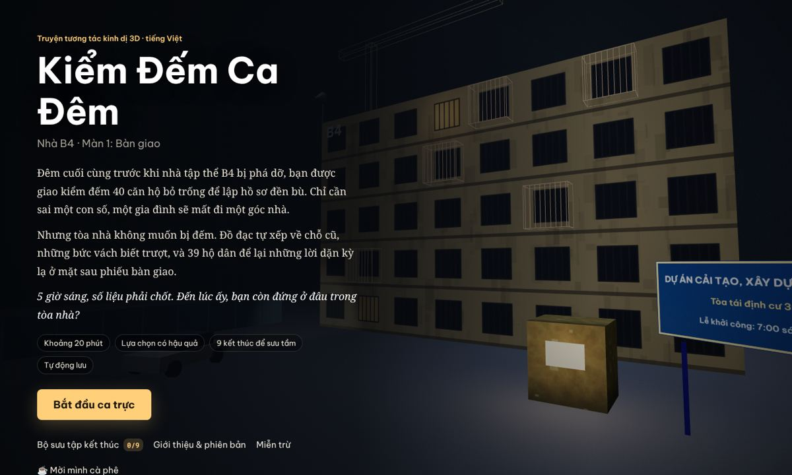
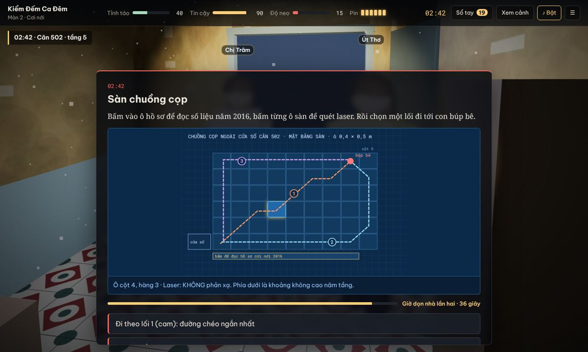
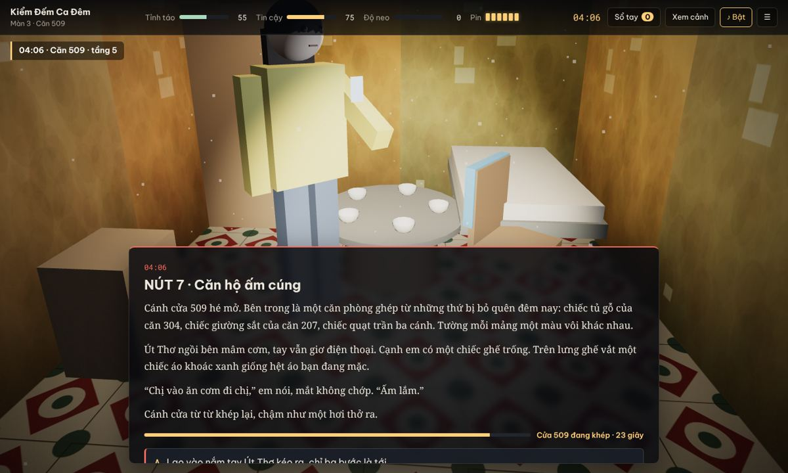

# Kiểm Đếm Ca Đêm · Nhà B4

**Truyện tương tác kinh dị tâm lý, có bối cảnh 3D, viết bằng tiếng Việt. Chơi miễn phí ngay trên trình duyệt.**

👉 **[Chơi ngay](https://kiemdem.hlvsuckhoe.com/)** · ✍️ **[Góp ý](https://github.com/nguyenducdungvn/kiem-dem-ca-dem/issues/new/choose)** · 🔔 **[Đăng ký nhận màn mới](https://github.com/nguyenducdungvn/kiem-dem-ca-dem/issues/1)** (bấm Subscribe)



> Đêm cuối cùng trước khi nhà tập thể B4 bị phá dỡ, bạn được giao kiểm đếm 40 căn hộ bỏ trống để lập hồ sơ đền bù. Chỉ cần sai một con số, một gia đình sẽ mất đi một góc nhà.
>
> Nhưng tòa nhà không muốn bị đếm. Đồ đạc tự xếp về chỗ cũ, những bức vách biết trượt, và 39 hộ dân để lại những lời dặn kỳ lạ ở mặt sau phiếu bàn giao.
>
> 5 giờ sáng, số liệu phải chốt. Đến lúc ấy, bạn còn đứng ở đâu trong tòa nhà?

## Trọn bộ 4 màn (v1.1.0)

| Màn | Thời gian | Bạn sẽ gặp |
|---|---|---|
| 1 · Bàn giao | 22:30 – 02:30 | Giờ dọn nhà, chiếc đồng hồ còn chạy, chiếc kẹp tóc dưới gầm giường |
| 2 · Cơi nới | 02:35 – 04:00 | Chuồng cọp đã tháo từ năm 2016, một con số ký khống, hộ dân cuối cùng |
| 3 · Căn 509 | 04:00 – 04:40 | Một căn hộ không có trong bản vẽ, mười hai nghìn người đang xem livestream |
| 4 · Chốt sổ | 05:00 – 07:30 | Lần ký cuối cùng, lễ bàn giao chìa khóa, và một năm sau |

- Khoảng 80 phút chơi. Có **27 kết thúc** để sưu tầm và 27 manh mối.
- Lựa chọn có hậu quả xuyên suốt 4 màn. Có đồng hồ đếm ngược ở các nút nguy hiểm.
- Mini-game theo đúng nghề trắc địa: đọc bản vẽ hoàn công, quét laser, đối chiếu hồ sơ, chọn mốc đo.
- Bối cảnh 3D dựng hoàn toàn bằng code: tường vôi vàng, gạch hoa, chuồng cọp, loa phường.
- Âm thanh và nhạc nền tự tạo, đổi theo không khí từng màn (đêm, căng thẳng, bình minh). Font tiếng Việt chuẩn có sẵn trong dự án, chơi được cả khi không có mạng.

### Mới ở bản 1.1
- **Chế độ đọc truyện:** bật ở màn hình chính. Không có đồng hồ đếm ngược, chỉ số không làm bạn thua. Hợp với ai muốn đọc thong thả.
- **Thẻ minh họa** cho cả 27 kết thúc trong Bộ sưu tập.
- **Phím tắt:** 1–4 hoặc A–D để chọn · Space/Enter hiện hết chữ · J sổ tay · H ẩn chữ · M âm thanh.
- **Nút chia sẻ kết thúc**, ảnh xem trước khi dán link lên mạng xã hội. Xem đầy đủ trong [CHANGELOG.md](CHANGELOG.md).

| | |
|---|---|
|  |  |

## Góp ý và nhận câu chuyện tiếp theo

- Trong game: khi chơi xong, hoặc ở màn hình chính, bấm **✍️ Góp ý**. Nội dung sẽ được điền sẵn vào một Issue trên GitHub.
- Hoặc mở trực tiếp: [Góp ý, nhận xét](https://github.com/nguyenducdungvn/kiem-dem-ca-dem/issues/new?template=gop-y.yml) · [Báo lỗi kỹ thuật](https://github.com/nguyenducdungvn/kiem-dem-ca-dem/issues/new?template=loi-ky-thuat.yml)
- Muốn nhận tin khi có mùa mới: mở [trang đăng ký](https://github.com/nguyenducdungvn/kiem-dem-ca-dem/issues/1) và bấm **Subscribe**, hoặc bấm **Watch → Custom → Releases** ở đầu trang này.

## ☕ Mời tác giả một ly cà phê

Game miễn phí và sẽ luôn miễn phí. Nếu câu chuyện làm bạn thức khuya thêm một chút:


BIDV · 3210256468 · NGUYEN DUC DUNG

---

## Dành cho người phát triển

### Chạy trên máy
Mở trực tiếp `index.html` bằng trình duyệt. Không cần cài gì, không cần build.

### Cấu trúc
```
index.html              Màn hình chính, HUD, khung lời kể, các hộp thoại
css/fonts.css, fonts/   Font tiếng Việt tự host (Be Vietnam Pro, Noto Serif, Roboto Mono – SIL OFL)
css/style.css           Giao diện
js/config.js            Tác giả, mời cà phê, góp ý, đăng ký nhận tin  ← sửa thông tin ở đây
js/vendor/three.min.js  Three.js r128 (MIT)
js/scene3d.js           Bối cảnh 3D dựng bằng code
js/audio.js             Âm thanh tự tạo (WebAudio)
js/engine.js            Engine: chỉ số, đồng hồ, lưu game, chọn màn, bộ sưu tập kết thúc, góp ý
js/story-act1..4.js     Nội dung 4 màn
docs/                   Kịch bản từng màn, HANDOFF.md (bàn giao để phát triển tiếp)
tools/check.js          Kiểm tra mọi nhánh truyện
tools/export.js         Xuất kịch bản ra Markdown
```

### Kiểm tra sau khi sửa truyện
```bash
node tools/check.js js/story-act1.js js/story-act2.js js/story-act3.js js/story-act4.js
node tools/export.js js/story-act1.js js/story-act2.js js/story-act3.js js/story-act4.js > docs/_xuat.md
```

### Xuất bản
Repo đã cấu hình để GitHub Pages phục vụ từ nhánh `main`, thư mục gốc, tên miền riêng `kiemdem.hlvsuckhoe.com` (tệp `CNAME`; bản ghi CNAME `kiemdem` trên Cloudflare trỏ về `nguyenducdungvn.github.io`). Nếu Pages chưa bật: vào **Settings → Pages → Deploy from a branch → main / (root) → Save**.

## Bản quyền và miễn trừ
- Nội dung truyện © Nguyễn Đức Dũng. Mọi nhân vật, địa danh (khu tập thể Tân Hòa, nhà B4) và sự kiện đều hư cấu.
- Game không nhằm đánh giá hay công kích cá nhân, tổ chức hay chính sách nào. Các chi tiết về đền bù, hệ số K và kiểm đếm bắt buộc đã được đơn giản hóa để phục vụ cốt truyện, không phải tư vấn pháp lý.
- Trang dùng Cloudflare Web Analytics để đếm lượt xem: không cookie, không lưu địa chỉ IP. Tiến trình chơi chỉ lưu trên trình duyệt của bạn. Góp ý chỉ được gửi khi bạn tự bấm gửi.
- Thư viện Three.js theo giấy phép MIT (`js/vendor/THREE-LICENSE.txt`). Font theo giấy phép SIL Open Font License (`fonts/LICENSE-*.txt`).
- Kịch bản và mã nguồn được thực hiện cùng Claude (Anthropic).
